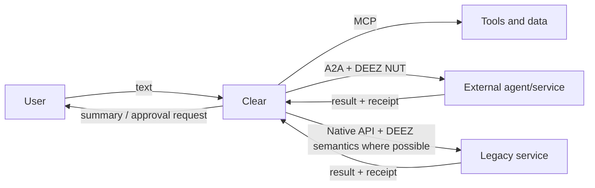
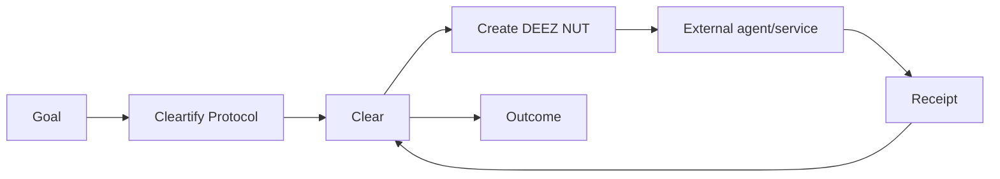

# ADR-0006: DEEZ delegation protocol and NUTS task envelopes

- **Status:** Accepted
- **Date:** 2026-10-05

## Context

Clear will routinely act on a user's behalf across external services, tools, and other agents. Existing interoperability mechanisms should be reused rather than replaced:

- tool/data access should use MCP when a compatible MCP interface exists;
- agent-to-agent delegation should use A2A or another compatible agent transport when available;
- native APIs remain acceptable when neither standard interface exists.

Those transports do not by themselves define Cleartify's product-specific semantics for **what a human actually authorized Clear to do**. Clear needs a portable, auditable representation of delegated intent, authority, constraints, disclosure limits, approval requirements, expiry, revocation, and outcome receipts.

## Decision

Cleartify will define an open delegation layer named **DEEZ**:

> **D**elegated **E**xecution, **E**ntitlements & **Z**ero-trust

A single delegation artifact is a **NUTS** document:

> **N**egotiated **U**ser **T**ask **S**pecification

The developer-facing phrase is intentionally memorable:

> **Agents use DEEZ NUTS to prove what they are allowed to do.**

DEEZ is **not** a replacement for MCP or A2A. It is a semantic delegation layer that can travel over existing transports. The preferred initial integration is an A2A extension/metadata envelope, while MCP remains the primary tool/data interface where appropriate.

The canonical public developer/spec domain is **`deez.run`**. Cleartify may host product documentation under `cleartify.com`, but DEEZ should be independently documentable and implementable from `deez.run` so it can become useful outside Cleartify.

## DEEZ responsibilities

A DEEZ NUT MUST be able to represent at least:

1. **Principal** — the human or organization on whose behalf the request is made.
2. **Intent** — the requested outcome, not merely a low-level function call.
3. **Authority** — the actions Clear may take.
4. **Constraints** — price, time, location, policy, safety, or other boundaries.
5. **Disclosure** — which user data may be shared with the receiving party.
6. **Approval policy** — which actions are pre-authorized and which require the principal again.
7. **Expiration** — when the delegation becomes invalid.
8. **Revocation** — how authority can be withdrawn before expiration.
9. **Receipt policy** — what evidence/result must be returned after execution.
10. **Delegation identity** — a stable identifier suitable for auditing and idempotency.

Future versions may add signatures, capability proofs, chained/sub-delegation, selective disclosure, delegated payment authority, and cryptographic verification. Those are not required for the MVP unless needed by a concrete integration.

## Conceptual example

```yaml
nut:
  id: nut_01J...
  principal: did:plc:example
  intent:
    type: travel.book_hotel
    summary: Book a hotel near the conference

  authority:
    allow:
      - travel.search
      - travel.reserve

  constraints:
    max_price_usd_per_night: 250
    refundable_only: true
    max_distance_miles: 1

  disclosure:
    allow:
      - name
      - email
      - payment_token
    deny:
      - private_memory
      - unrelated_calendar

  approval:
    required_if:
      - price_usd_per_night > 225

  expires_at: 2026-10-10T21:00:00Z

  receipt:
    required: true
    include:
      - selected_option
      - alternatives_considered
      - amount
      - reason
```

The concrete wire schema will be versioned separately from this ADR.

## Transport model



DEEZ defines the **delegation semantics**; the surrounding transport remains replaceable.

## Relationship to Cleartify protocols

Cleartify **Protocols** define how Clear accomplishes a repeatable goal for a user. DEEZ defines what authority Clear carries across a trust boundary when a protocol needs another service or agent to act.



A protocol may create multiple NUTS during one run, each scoped only to the authority needed for that external interaction.

## Security principles

1. **Least authority.** A NUT grants only what is necessary for one task or bounded task family.
2. **Explicit limits.** Open-ended permissions should be avoided when constraints can be expressed.
3. **Data minimization.** Disclosure is separately scoped from action authority.
4. **Human re-approval.** Crossing an approval boundary pauses execution and returns control to the principal.
5. **Short lifetime.** Delegations expire; persistent access should use a separate explicit grant model.
6. **Revocability.** A principal must be able to withdraw active authority.
7. **Auditable receipts.** Consequential execution produces a durable record of what happened and why.
8. **Transport independence.** DEEZ semantics should not require Cleartify, a particular model vendor, or a particular agent transport.

## Naming and developer experience

The humorous naming is intentional. The specification must remain technically serious even when the API and documentation are memorable.

Potential developer surfaces:

```text
deez.run/spec
deez.run/docs
deez.run/nuts
deez.run/examples
```

Illustrative CLI/API vocabulary:

```bash
deez nut create
deez nut inspect
deez nut verify
deez nut revoke
```

Illustrative library vocabulary:

```go
nut := deez.NewNut(...)
err := deez.Verify(nut)
```

These names are examples, not yet stable API commitments.

## Consequences

### Positive

- Cleartify reuses MCP/A2A instead of building an incompatible agent ecosystem.
- human authority becomes explicit instead of implicit in a prompt;
- external services can reason about what Clear is and is not allowed to do;
- privacy/disclosure constraints travel with the delegated task;
- receipts create an audit trail suitable for user trust and future compliance needs;
- DEEZ can become independently useful to other assistants and services;
- `deez.run` gives the protocol a memorable standalone developer identity.

### Negative

- Cleartify now owns a public specification that must be carefully versioned;
- authorization semantics become security-sensitive infrastructure;
- premature complexity could slow the product if DEEZ is generalized before real integrations require it;
- naming that is useful for developer virality may be inappropriate in some enterprise contexts, so documentation should always expose the formal expansion alongside the joke.

## MVP scope

For the Cleartify MVP, DEEZ should begin as an **internal typed delegation envelope** used between Clear's protocol/runtime layers and external integrations. We should not delay Clear's core messaging product waiting for a public standard.

The order is:

1. implement the envelope internally;
2. use it in real integrations;
3. publish the minimal schema that has proven useful;
4. map it cleanly onto A2A extension metadata;
5. publish reference docs/examples at `deez.run`;
6. open-source SDKs only after the schema stabilizes through actual use.

## Non-goals

- replacing MCP;
- replacing A2A;
- inventing a new network transport;
- exposing DEEZ/NUTS terminology to ordinary Cleartify users;
- making every simple tool call require a heavyweight delegation negotiation.
