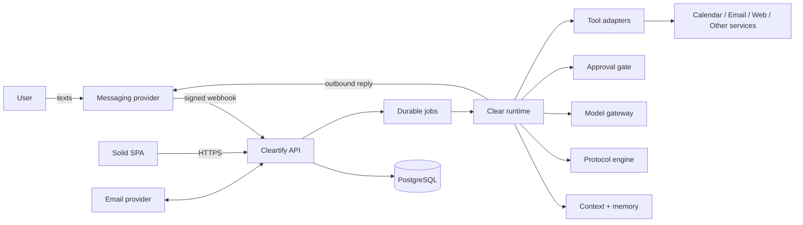
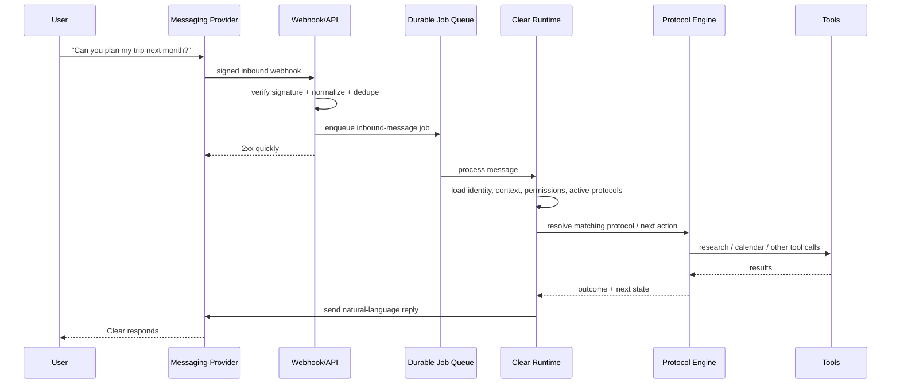
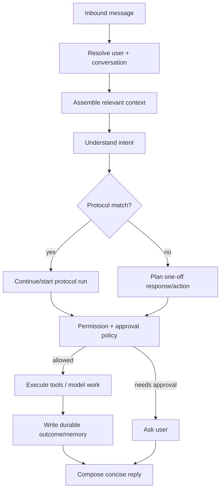
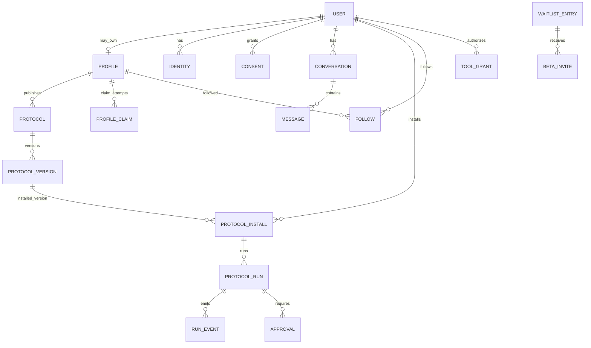

# System Architecture

## Architectural stance

Start as a **modular monolith plus background workers**, not microservices. The product is early; the hard problems are product behavior, trust, integrations, and durable execution — not service topology.

The web SPA and messaging runtime share one API/backend boundary, but texting Clear does **not** depend on the SPA being open.

### Initial stack

- **Web:** SolidJS 2, TypeScript, Solid Router, StyleX, Vite.
- **API/runtime:** Go service with clear internal modules.
- **Primary database:** PostgreSQL.
- **Background work:** durable PostgreSQL-backed job queue/worker abstraction initially.
- **Object storage:** optional for large artifacts/attachments.
- **Email provider:** adapter interface; use for waitlist, newsletters, transactional mail, and beta invitations.
- **Messaging provider:** adapter interface for SMS/RCS/other supported text channels.
- **Model gateway:** provider-neutral model interface; route by task/cost/quality.
- **Payments:** add behind an interface when paid protocols enter beta.

## Top-level view



## Backend modules

Keep these as modules/packages in one Go codebase until scaling or reliability requirements justify separation.

```text
internal/
  accounts/          users, identities, sessions
  waitlist/          signup + consent + referrals
  invites/           beta invitation + 5-digit verification
  messaging/         inbound/outbound provider adapters
  conversations/     threads + message events
  clear/             assistant orchestration
  memory/            long-lived personal context
  protocols/         definitions, versions, installs, runs
  approvals/         consequential-action policy and grants
  tools/             email/calendar/browser/etc adapters
  profiles/          public/creator/unclaimed profiles
  marketplace/       discovery, entitlements, offers
  notifications/     transactional + newsletter sends
  billing/           future paid protocol/subscription support
  jobs/              durable asynchronous execution
```

## Text message lifecycle



### Important property

Inbound webhooks acknowledge quickly. Long model/tool work happens asynchronously. Every externally visible message/action gets an idempotency key so retries do not duplicate sends or purchases.

## Clear runtime

Clear is an orchestrator, not one giant prompt.



### Runtime concepts

- **Conversation:** the natural text thread with Clear.
- **Memory:** durable facts/preferences/relationships learned with provenance and user controls.
- **Responsibility:** an ongoing outcome Clear owns, such as “keep chasing support until resolved.”
- **Protocol:** reusable executable playbook.
- **Protocol run:** one instance of a protocol for one user.
- **Approval:** explicit user authority for a consequential step.
- **Tool grant:** scoped permission to access an external service.

## Data model overview



## Suggested core tables

### Identity and access

- `users`
- `identities` — phone/email/provider identity mappings
- `sessions`
- `tool_grants`
- `consents`

### Launch funnel

- `waitlist_entries`
- `beta_invites`
- `beta_code_attempts`
- `notification_deliveries`

### Messaging / assistant

- `conversations`
- `messages`
- `memories`
- `responsibilities`
- `approvals`
- `jobs`

### Protocols

- `protocols`
- `protocol_versions`
- `protocol_installs`
- `protocol_runs`
- `protocol_run_events`
- `protocol_offers`
- `entitlements`

### Social / creator layer

- `profiles`
- `profile_sources`
- `profile_claims`
- `follows`

## Deployment shape for MVP

```mermaid
flowchart TB
    DNS[cleartify.com] --> EDGE[HTTPS / reverse proxy]
    EDGE --> APP[Go API + embedded or separately served SPA]
    EDGE --> WEBHOOK[/webhooks/messaging]
    WEBHOOK --> APP
    APP --> PG[(PostgreSQL)]
    WORKER[Go worker process] --> PG
    APP --> PROVIDERS[Email + Messaging + Model + Tool providers]
    WORKER --> PROVIDERS
```

One repository can build two process modes from the same Go codebase: `api` and `worker`. The SPA can later be embedded into the Go binary for a single deployable artifact if desired.

## Scale triggers

Do not split services because something feels “enterprise.” Split only when a real boundary appears, e.g.:

- messaging webhook throughput needs independent scaling;
- browser/tool execution requires isolated sandbox infrastructure;
- marketplace payments need stronger operational isolation;
- protocol workers have materially different compute/runtime needs;
- compliance requires a separate trust boundary.
