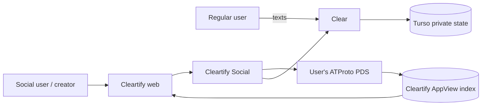
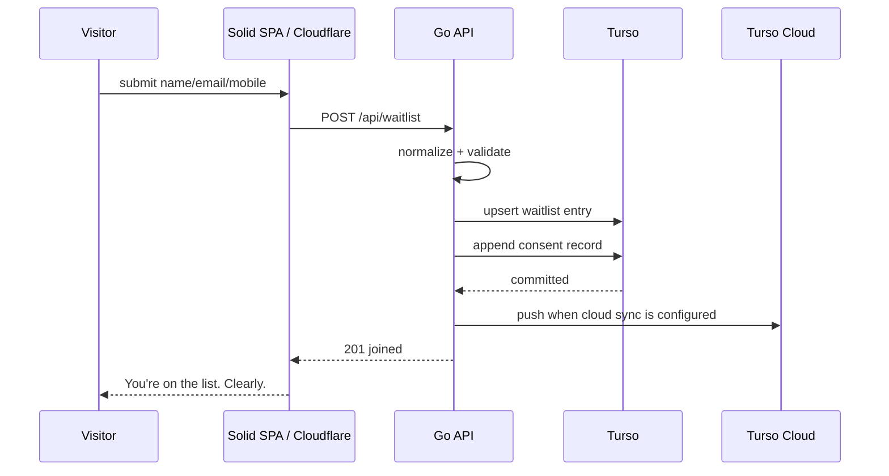
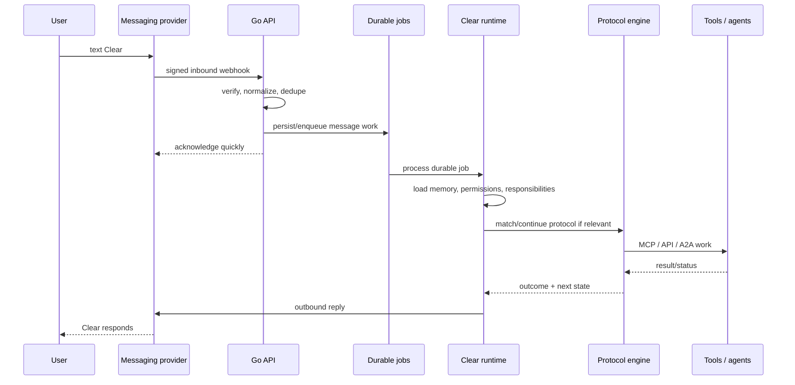
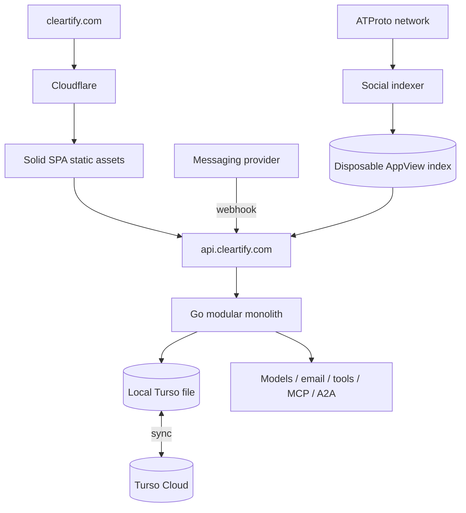

# System Architecture

## Architectural stance

Start as a **modular Go monolith plus durable workers**, not microservices.

Cleartify has two product planes:

- **Clear** is the private assistant a normal user texts.
- **Cleartify Social** is the optional public layer for profiles, creators, protocols, discovery, and the marketplace.

The web SPA is useful for onboarding, permissions, discovery, creator tools, and settings. It is not required to keep a text conversation with Clear alive.

## Initial stack

- **Web:** SolidJS 2, TypeScript, Solid Router, StyleX, Vite.
- **Public web hosting:** Cloudflare Workers Static Assets.
- **API/runtime:** Go.
- **Private database:** SQLite-compatible Turso.
- **M1 database topology:** local Turso database file with optional Turso Cloud sync; one writer process.
- **Backend deployment:** Docker, initially suitable for Fly.io; no Fly-specific application code.
- **Public/social data:** optional ATProto records in a user's PDS.
- **Social search/AppView:** disposable Turso index derived from public ATProto records.
- **Messaging:** provider adapter for SMS/RCS/other supported text channels.
- **Models:** provider-neutral model gateway.
- **Tool interoperability:** MCP where available.
- **Agent interoperability:** A2A where available, with DEEZ/NUTS delegation semantics when Clear acts for a user.

## Product/data split



### Clear: private plane

A regular user needs only a verified mobile identity plus an internal Cleartify user ID.

Private data includes:

- waitlist/invite state;
- phone and email mappings;
- conversations;
- memories;
- reminders and responsibilities;
- private protocol installations;
- protocol run state;
- approvals;
- credentials/tool grants;
- billing and entitlements.

This data stays in Cleartify's private Turso plane.

### Cleartify Social: optional public plane

ATProto is introduced only when a user wants public/social capabilities such as:

- a public profile;
- publishing protocols;
- following creators publicly;
- claiming a seeded profile;
- creator verification;
- public protocol collections.

Existing ATProto users bring their current DID/PDS. New social users should be able to use Bluesky-hosted ATProto account/PDS infrastructure so Cleartify does not operate PDS servers.

ATProto is not used as private assistant memory storage.

## M1 request path



The landing page must never fake a successful signup if the backend failed.

## Text message lifecycle



Long-running work is represented durably in Turso. Goroutines may execute work, but an in-memory goroutine is never the source of truth for an ongoing responsibility.

## Go module boundaries

Keep these as packages in one codebase until a real scaling or security boundary appears.

```text
cmd/cleartify/

internal/
  api/
  config/
  database/
  waitlist/
  accounts/
  invites/
  messaging/
  conversations/
  clear/
  memory/
  protocols/
  approvals/
  tools/
  jobs/
  social/
  atproto/
  marketplace/
  billing/
  notifications/
```

## Private data model

The first schema starts with launch data:

- `waitlist_entries`
- `consents`

Later private tables include:

- `users`
- `phone_identities`
- `beta_invites`
- `sessions`
- `conversations`
- `messages`
- `memories`
- `responsibilities`
- `jobs`
- `approvals`
- `tool_grants`
- `protocol_installs`
- `protocol_runs`
- `entitlements`

Public creator/protocol records should not automatically be duplicated as canonical private records. Turso may hold a rebuildable index for search and ranking.

## Deployment shape



For M1, run **one backend writer**. This keeps Turso local-first sync semantics simple. When horizontal API scaling becomes necessary, move the private store to a direct remote/serverless Turso topology or another supported multi-writer arrangement without changing the domain interfaces.

## Docker portability

The backend must remain runnable as:

```bash
docker run cleartify
```

Application code must not depend on Fly.io APIs. Fly can be the first container host, while Cloudflare handles DNS, TLS, CDN, and the SPA. Cloudflare Containers or another host can be evaluated later without rewriting Clear.

## Scale triggers

Split components only when a measured boundary appears, for example:

- messaging webhook volume needs independent scaling;
- browser execution needs an isolated sandbox;
- protocol jobs have materially different resource requirements;
- creator billing needs a stronger trust boundary;
- ATProto indexing becomes operationally independent;
- private database topology needs multi-region/multi-writer behavior.
