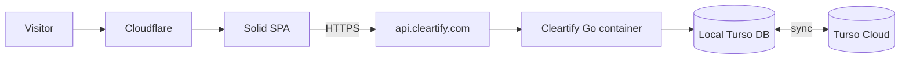

# Deployment

## Goal

Keep the deployment boring and portable:

- Cloudflare handles the public web edge.
- The Solid SPA is static.
- The Go backend is one Docker image.
- Turso provides SQLite-compatible private state and cloud durability.
- ATProto is a later public/social data plane, not part of M1 deployment.

## M1 topology



Recommended first deployment:

- **Cloudflare Workers Static Assets** for the SPA.
- **Fly.io** for one always-available Go Machine/container.
- **Fly Volume** mounted at `/data` for the local database file.
- **Turso Cloud** configured as the remote sync target.
- Cloudflare DNS/TLS in front of both domains.

This keeps the first production architecture close to local development and preserves a normal Docker boundary.

## Domains

Suggested routing:

```text
cleartify.com         Solid SPA / public site
www.cleartify.com     redirect to cleartify.com
api.cleartify.com     Go API
```

Later:

```text
deez.run              DEEZ/NUTS developer/spec site
```

## Go toolchain

The minimum module version is Go 1.26.0. CI uses Go 1.26.1 and the Docker builder uses `golang:1.26.1-bookworm`. Upgrade local Go to 1.26.1 before running `go test -p 1 ./...`, `go mod verify`, and production-equivalent Docker builds. The Turso embedded native library must be verified by the Go and Docker CI jobs before deployment. This change does not alter production database schema or runtime flags.

## Backend container

The backend must remain runnable with ordinary Docker:

```bash
docker build -t cleartify .
docker run --rm \
  -p 8080:8080 \
  -e APP_ORIGIN=https://cleartify.com \
  -e DATABASE_PATH=/data/cleartify.db \
  -e TURSO_REMOTE_URL=... \
  -e TURSO_AUTH_TOKEN=... \
  -v cleartify-data:/data \
  cleartify
```

Do not add Fly-specific application code. Fly is a host, not an architectural dependency.

## Frontend

Build-time configuration:

```text
VITE_API_BASE_URL=https://api.cleartify.com
```

The SPA calls the API directly over HTTPS with browser credentials included. Set `APP_ORIGIN` to the exact SPA origin, for example `https://cleartify.com`; the API allows credentialed CORS only for that origin, including PUT/DELETE preflights.

Keep the SPA and API same-site (for example `https://cleartify.com` and `https://api.cleartify.com`). Session cookies use `SameSite=Strict`, and protected mutations reject cross-site requests. Separate origins on unrelated domains are not a supported authenticated deployment. A shared origin with an `/api/*` proxy also works. Locally, keep both services on `localhost` or both on `127.0.0.1` and use the corresponding exact `APP_ORIGIN`.

A future Cloudflare Worker may proxy `/api/*` to the API so the browser can use a single origin, but M1 does not require that indirection.

## Turso modes

### Local development

```text
DATABASE_PATH=./data/cleartify.db
```

No remote database is required.

### M1 production

```text
DATABASE_PATH=/data/cleartify.db
TURSO_REMOTE_URL=...
TURSO_AUTH_TOKEN=...
```

The Go service opens the local SQLite-compatible database and uses Turso sync for cloud durability.

M1 intentionally uses one backend writer process. This avoids pretending local-first sync is a transparent multi-writer cluster.

### Later scale

When horizontal API scaling is required, evaluate Turso's direct serverless/HTTP driver or another supported remote multi-writer topology. Keep this change behind the database package so application domains do not care where SQL executes.

## Secrets

Never commit:

- Turso auth tokens;
- messaging provider credentials;
- model provider API keys;
- email provider credentials;
- ATProto OAuth secrets;
- payment secrets.

Use the host's secret manager.

## Health and deploy checks

The container exposes:

```text
GET /healthz
```

A deployment is healthy only when:

1. the process starts;
2. database migration succeeds;
3. `/healthz` returns 200;
4. a waitlist request can be written;
5. the SPA can reach the API from the configured origin.

## Future Cloudflare Container option

The Docker boundary lets us evaluate Cloudflare Containers later. Do not move the backend merely to make the diagram look simpler; compare cost, cold-start behavior, persistent/background-work needs, and operational simplicity after M2/M3 are running.


## Audit-repair database upgrades

Startup records schema migrations and rejects databases containing declared foreign-key violations; it does not delete or repair historical rows automatically. Back up the database before upgrade. New publication/digest fields deliberately leave legacy slug-only installations unbound until explicit reinstall/acknowledgment, and old unpinned Clear requests cannot be approved. Pending beta invitations issued before identity snapshots must be reissued. See [audit upgrade requirements](audit/remaining-findings-repairs.md#upgrade-and-behavior-requirements) before rolling out these local changes.
