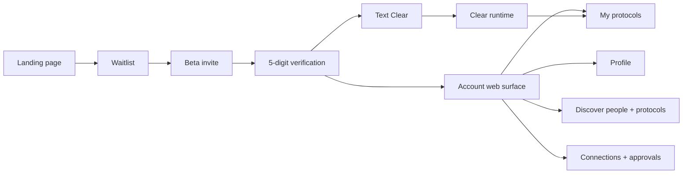

# MVP Plan

## MVP question

Can we make a person think **“I should text Clear”** when something enters their head, and can Clear reliably move that thing toward a real outcome?

The MVP is not “build every personal assistant feature.” It is a deliberately narrow loop that proves:

1. people will join;
2. invited users will activate;
3. texting Clear feels natural;
4. Clear can remember useful context;
5. Clear can run basic protocols;
6. people will install/share protocols from profiles;
7. users gradually trust Clear with more authority.

## Product surfaces

## M0 — Foundation

**Goal:** establish the product contract and public story.

Deliverables:

- SolidJS 2 + TypeScript + Solid Router + StyleX SPA.
- Meme-friendly landing page based on the approved visual concept.
- `/@chris` profile preview to prove the social/protocol model.
- Architecture, protocol, profile/marketplace, launch funnel and ADR docs.
- `dev` integration branch and feature → dev → main workflow.

Success check:

- A stranger can see the landing page and correctly explain: “I text Clear; Clear remembers stuff and gets things done.”
- A stranger can see `/@chris` and understand that protocols can be installed from a person.

## M1 — Waitlist + invitation funnel

M1 uses the Go backend and private SQLite/Turso state. ATProto is not part of regular-user activation.

### Slice 1 — waitlist foundation

- real `POST /api/waitlist`;
- collect name, email, E.164 mobile number;
- append marketing-consent evidence;
- email/phone dedupe;
- local SQLite-compatible development database;
- optional Turso Cloud sync;
- Docker build;
- health endpoint;
- CI for both web and Go.

### Slice 2 — invitation + activation

- admin invite action;
- transactional invite email;
- one-time high-entropy invite URL;
- 5-digit code sent to the stored phone after link validation;
- attempt limits, expiry, resend cooldown;
- internal Cleartify user ID + verified phone identity;
- starter protocols installed;
- first welcome text from Clear.

Success check:

> A new visitor joins → receives a beta invite → verifies the phone number → activates without creating an ATProto/social account.

## M2 — Text Clear loop

Build:

- one inbound phone number;
- provider webhook signature verification;
- phone → user identity mapping;
- normalized inbound/outbound message model;
- durable job processing;
- model gateway;
- short conversation history;
- first persistent memories;
- concise response voice.

Initial capabilities should stay intentionally narrow:

- remember a preference or commitment;
- answer from recent conversation/context;
- create simple reminders/responsibilities;
- start/stop a starter protocol;
- explain what Clear can currently do.

Success check:

> User texts from their normal messaging app and receives a useful Clear response without opening Cleartify.

## M3 — Starter protocols

Every activated beta user automatically receives a starter pack:

- **Weekly Reset** — review open commitments and upcoming week.
- **Follow Through** — track an outcome and keep following up.
- **Remember This** — save a durable preference/fact with provenance.
- **Daily Clear** — one concise check-in about what matters today.

Optional installs:

- Trip Planning
- Ship It
- Inbox Follow-up

Users can manage protocols by text:

> “What protocols do I have?”

> “Turn on Weekly Reset.”

> “Pause Daily Clear.”

…and later through the web UI.

Success check:

> A nontechnical user can enable, pause, inspect and run a protocol without seeing JSON, agents, prompts, or workflow nodes.

## M4 — Profiles + social discovery

This is the point where optional ATProto identity enters the product. Regular Clear users can browse and install public protocols without needing a DID/PDS.

Build:

- `/@handle` public profile routes;
- creator/public profile opt-in;
- connect an existing ATProto identity or create one through hosted infrastructure;
- public Cleartify records in the user's PDS;
- Chris as the default first friend/follow for users who enter the social experience;
- public list of protocols a creator chooses to share;
- “running now” count only when explicitly public;
- follow/unfollow;
- protocol install from profile for both social and non-social users;
- shareable protocol/profile links;
- disposable AppView/search index in Turso.

Seed a small set of **unclaimed** public-interest profiles only when supported by sourced public information. They must be visibly labeled unclaimed and must not imply endorsement.

Success check:

> A beta user visits Chris → sees a protocol → installs it → it appears in their own Clear setup.

## M5 — Creator Studio

Build a power-user surface for creating protocols:

1. metadata: name, purpose, category, cover;
2. triggers: manual/schedule/event;
3. inputs and configuration;
4. declarative steps;
5. required permissions;
6. approval rules;
7. test with sample data;
8. version + changelog;
9. publish public/unlisted/private;
10. share URL.

Later add “teach Clear this workflow” so a repeated conversation can be converted into a draft protocol.

Success check:

> A creator can publish a protocol without writing application code, and an average user can install it safely.

## M6 — Marketplace + premium protocols

Build:

- free protocols;
- one-time paid protocols;
- subscription protocols/creator membership;
- entitlements;
- creator earnings ledger;
- refunds/support path;
- ranking that separates popularity from sponsorship;
- protocol reviews after actual use, not merely purchase.

Only claimed/verified creator profiles may monetize.

Success check:

> A creator publishes a paid protocol → user unlocks it → entitlement installs it → creator can see the sale.

## M7 — Tool connections and real execution

Prioritize integrations based on observed beta demand rather than breadth.

Likely order:

1. calendar;
2. email;
3. browser/web tasks;
4. files/drive;
5. developer/work tools for power users.

Each connector must expose narrow tool capabilities and permission scopes; protocols declare what they need before installation.

## M8 — Proactivity and long-running responsibilities

Clear becomes useful between messages:

- scheduled protocol triggers;
- event triggers;
- waiting states;
- follow-up deadlines;
- proactive check-ins;
- “I handled this while you were away” summaries;
- escalation only when the user is actually needed.

This is where **outcomes over answers** becomes obvious.

## Metrics that matter

Avoid optimizing solely for chat volume.

### Activation

- landing → waitlist conversion;
- invite → activation conversion;
- activation → first text;
- time to first useful outcome.

### Trust ladder

Track the percentage of activated users who progress through:

1. ask Clear a question;
2. save a memory;
3. install a protocol;
4. connect a service;
5. approve an external action;
6. delegate an ongoing responsibility;
7. grant scoped repeat authority.

A useful internal metric is **Time to Authority**: how long until the user safely says some version of “just handle it.”

### Protocol flywheel

- profile views → protocol installs;
- install → first successful run;
- 7/30-day protocol retention;
- protocols shared per creator;
- installs driven by creator links;
- free → premium conversion when monetization exists.

## Not MVP

Do not build these before the core loop works:

- visual multi-agent management;
- dozens of integrations;
- enterprise org charts;
- arbitrary user code execution in protocols;
- public activity feeds for everyone;
- a fully automated ad marketplace;
- autonomous high-risk purchasing.
