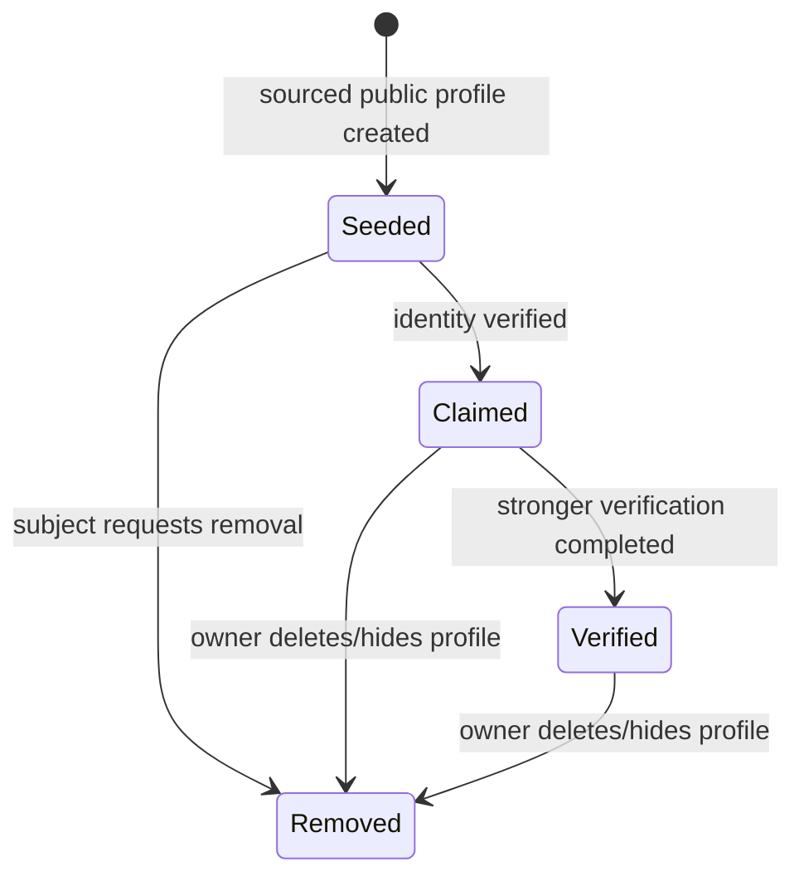
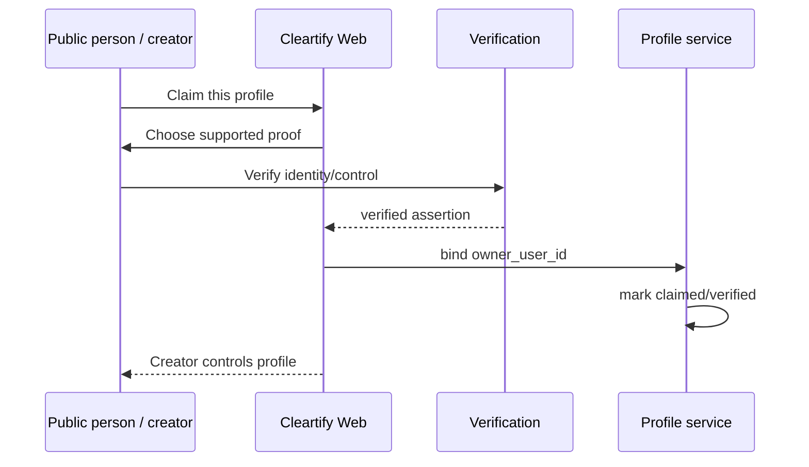
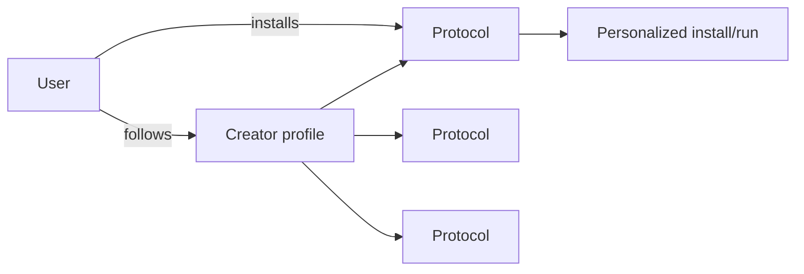
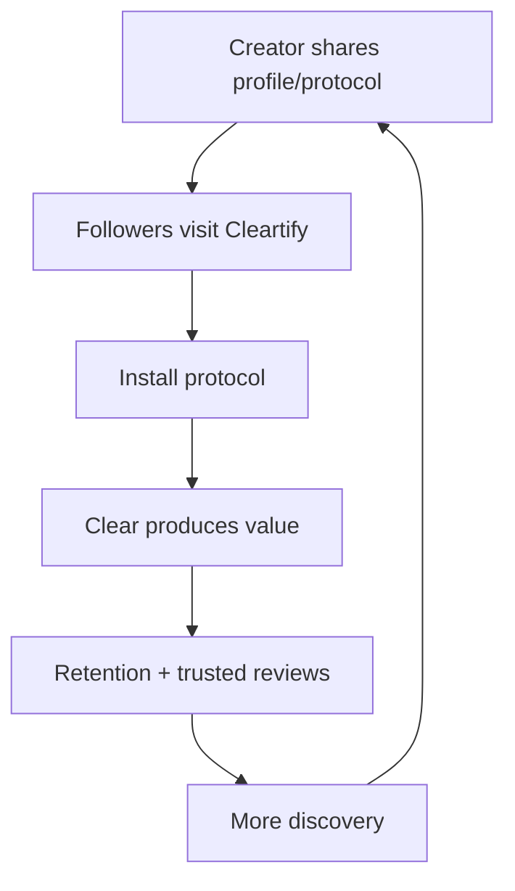

# Profiles and Protocol Marketplace

## Thesis

The marketplace should be **people-first, protocol-second**.

People are more likely to care about:

> “What systems does this person actually use?”

than:

> “Browse 4,000 anonymous workflow templates.”

A Cleartify profile is therefore a public page for the ways a person chooses to operate.

## The first-friend mechanic

New users automatically follow **Chris** as their first Cleartify friend.

The intent is playful and useful:

- the network is not empty on day one;
- the profile teaches the social model;
- Chris can publish a small starter set of useful protocols;
- users immediately see how install/share works;
- the user can unfollow at any time.

Example:

```text
Chris
@chris

10 protocols running
6 public · 2 premium

🚀 Ship It                    Free
🧹 Weekly Reset              Free
💡 Weekend MVP               $4
📚 Exam Sprint               $3/mo
🔁 Follow Through            Free
```

“10 protocols running” is public only because Chris opted in to showing that activity.

## Privacy model

Normal accounts are private by default.

Separate three concepts:

1. **installed protocols** — private by default;
2. **current run/activity state** — private by default;
3. **published protocol/profile catalog** — explicitly public.

A creator can choose to expose:

- protocol names they use;
- protocol templates they publish;
- selected aggregate counts such as “10 running”;
- public notes/about/bio;
- public collections such as “My morning stack.”

Never infer that private installation or execution history should become public.

## Profile lifecycle

A profile does not require an account owner.



Suggested fields:

```text
profiles
  id
  owner_user_id nullable
  handle
  display_name
  bio
  avatar_url
  profile_type          # person | organization | curator
  claim_state           # unclaimed | claimed | verified
  public_visibility
  protocol_activity_visibility
  created_at
  updated_at

profile_sources
  id
  profile_id
  field_or_protocol_ref
  source_url
  source_title
  source_published_at
  captured_at
  notes
```

## Seeded / unclaimed profiles

This is the cold-start mechanism for notable people whose methods are already discussed publicly.

An unclaimed profile must be unmistakable:

> **Unclaimed profile**  
> Compiled from public sources. This person has not endorsed or joined Cleartify.

Rules:

- only use information reasonably available from public sources;
- retain provenance/source links;
- distinguish direct statements from Cleartify/community interpretation;
- do not fabricate private habits;
- do not state “currently running” unless the profile owner has claimed the profile and opted into activity display;
- do not sell protocols as though the unclaimed person created/endorsed them;
- do not collect creator revenue for an unclaimed profile;
- offer a straightforward claim and removal/correction path.

For sourced playbooks, wording should be precise, e.g.:

> **Morning light routine**  
> Community-compiled from publicly documented material.  
> Not an official protocol until claimed/published by the profile owner.

## Claim flow



Verification can grow over time:

- verified email/domain;
- existing social account proof;
- manual review for high-profile creators;
- other trusted identity mechanisms.

The exact verification vendors/mechanisms are implementation details; the profile model should support multiple proofs.

## Discovery model

The primary graph is:



Marketplace discovery surfaces can include:

- people you follow;
- popular creators;
- protocol categories;
- “people who use this also use…”;
- featured collections;
- search by goal/problem;
- direct shared links.

The landing experience should lead with people and outcomes, not workflow internals.

## Protocol page

Example route:

```text
/@chris/protocols/ship-it
```

Show:

- creator;
- title + purpose;
- free/paid access;
- permission manifest;
- what it will and will not do;
- triggers and frequency;
- version/changelog;
- verified usage/outcome metrics when meaningful;
- install button;
- reviews only from users who actually installed/ran it.

## Monetization

Supported commercial models later:

### Free

Creator publishes for reach/community.

### One-time

User buys access to a specific protocol/major version policy.

### Subscription

User subscribes to creator/protocol membership for continuously maintained protocols.

### Bundle/collection

Creator sells a set such as:

> “My entire creator operating system.”

### Rules

- only claimed/verified creators monetize;
- marketplace fee is explicit;
- sponsorship never silently changes Clear's recommendation;
- paid ranking and organic ranking must be visually distinct;
- creator ownership and user entitlements survive normal protocol version updates according to the purchase terms.

## Creator flywheel



This is important because the creator's actual product lives inside Cleartify; they are not merely buying or posting an ad for Cleartify.

## Social features: intentionally limited at first

Build:

- follow creator;
- profile;
- public protocols;
- collections;
- share links;
- install counts/reviews with appropriate privacy.

Do **not** initially build:

- general status feed;
- public DMs;
- comments on everything;
- follower-count competition as the core product;
- public personal activity for ordinary users.

The social layer exists to distribute useful behavior, not to become another engagement feed.
