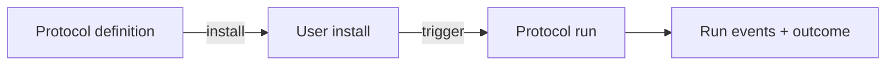
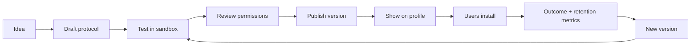

# Protocols

## What a protocol is

A **protocol** is a reusable, versioned, executable way of accomplishing a goal.

It is not a prompt library and it is not arbitrary uploaded code.

The average user should experience:

> “Turn on Weekly Reset.”

not:

> “Create an agent, choose a model, configure polling, write system instructions, connect tools, and manage retries.”

Clear owns the complexity.

## Three different objects



### Protocol definition

Published reusable template owned by a profile.

### Protocol install

A user's configured copy of one version/range of the protocol.

### Protocol run

One execution instance with state, inputs, approvals, events and outcome.

## Starter protocols

Every beta account receives safe basic protocols automatically:

### Weekly Reset

- trigger: weekly schedule or manual;
- reviews open responsibilities and next-week calendar once connected;
- asks what should be dropped/delegated;
- produces a short priorities summary.

### Follow Through

- trigger: manual;
- creates a durable responsibility;
- waits/rechecks on a reasonable cadence;
- reminds/follows up until success, cancellation, expiry or escalation.

### Remember This

- trigger: conversational intent;
- proposes durable memory when relevant;
- records source/provenance;
- lets the user inspect/correct it.

### Daily Clear

- trigger: optional daily schedule;
- says only what appears worth the interruption;
- may remain silent when there is nothing useful to say.

## Definition format

Start with a declarative schema represented as JSON internally. A friendly creator UI renders and edits it.

Conceptual example:

```json
{
  "schemaVersion": 1,
  "slug": "weekly-reset",
  "name": "Weekly Reset",
  "description": "Clear loose ends and decide what matters next week.",
  "triggers": [
    { "type": "schedule", "rule": "weekly" },
    { "type": "manual" }
  ],
  "inputs": [
    { "key": "reviewDay", "type": "dayOfWeek", "default": "sunday" }
  ],
  "permissions": [
    { "capability": "calendar.read", "required": false },
    { "capability": "responsibilities.read", "required": true }
  ],
  "steps": [
    { "id": "collect", "type": "collect_context" },
    { "id": "review", "type": "reason", "instructionRef": "review-open-loops" },
    { "id": "ask", "type": "ask_user", "when": "decision_required" },
    { "id": "summarize", "type": "notify" }
  ]
}
```

The production schema should avoid freeform expressions that become an accidental scripting language. Conditions should come from a constrained expression model.

## Supported step families

MVP step types:

- `reason` — model-supported structured reasoning/action choice;
- `collect_context` — retrieve memories, responsibilities or relevant records;
- `tool` — execute a named scoped capability;
- `ask_user` — pause for input/approval;
- `wait` — durable timed wait;
- `branch` — constrained condition;
- `notify` — send a message/update;
- `complete` — finish with structured result.

Later:

- event wait;
- subprotocol;
- bounded loop;
- parallel safe reads;
- human/creator-defined transform primitives.

## Permission manifest

A protocol declares capabilities before install.

Example:

```text
Weekly Reset wants:
✓ Cleartify responsibilities
○ Calendar — read events
○ Email — read selected metadata

It cannot:
× send email
× buy anything
× delete events
```

If a future protocol version adds a new permission, the install does not silently inherit it. Clear asks the user to approve the expanded scope.

## Approval model

Each action receives a policy classification:

- **read** — generally executable inside existing grant;
- **low-risk write** — optionally pre-authorized by scoped grant;
- **consequential** — explicit approval by default;
- **forbidden** — protocol cannot perform it.

Examples of consequential actions:

- purchase/financial commitment;
- sending a sensitive message as the user;
- destructive deletion;
- publishing private information;
- changing security/account controls.

## Average-user protocol UX

Discovery can happen entirely through conversation:

> User: “How do I stop forgetting to follow up with people?”  
> Clear: “I have a Follow Through protocol for that. Want me to turn it on?”

Or through a person's profile:

> Chris → **Ship It** → Install

Once installed, management stays natural:

- “What protocols are running?”
- “Pause Weekly Reset for two weeks.”
- “Make my reset Friday afternoon instead.”
- “Remove that protocol.”

## Creator workflow

Power users get a Creator Studio web surface.



Creator Studio should support:

- template metadata;
- human-readable purpose;
- inputs/defaults;
- triggers;
- declarative steps;
- permission manifest;
- approval behavior;
- sample-run simulator;
- version history/changelog;
- private/unlisted/public visibility;
- free/paid offer configuration after monetization launches.

## “Teach Clear” creation

A later high-leverage feature:

1. user teaches Clear how they perform something in normal conversation;
2. Clear notices the workflow is repeatable;
3. Clear proposes a draft protocol;
4. user edits/tests it;
5. user keeps it private or publishes it.

Example:

> Clear: “You've used feature → dev → main → release tag across several projects. Want me to turn that into your Ship It protocol?”

This turns actual behavior into reusable software.

## Versioning

Protocols are immutable per published version.

Suggested behavior:

- draft versions are editable;
- publishing creates immutable `protocol_version`;
- installs can auto-follow compatible versions;
- new permission requests force review;
- creator can deprecate but not silently rewrite an installed historical version;
- run record stores exact version used.

## Premium protocols

A protocol may have:

- free access;
- one-time purchase;
- recurring creator membership/subscription;
- private entitlement/grant.

Entitlement controls installation/use. It must not weaken the permission or approval model.

Only a claimed/verified profile may sell protocols.
