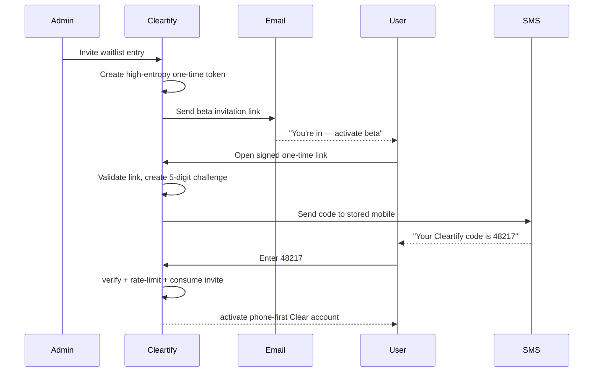

# Waitlist and Beta Access

## Goals

The launch funnel has three distinct jobs:

1. collect an interested person's contact details;
2. obtain explicit marketing consent for newsletters/product updates;
3. later convert selected people into verified phone-first beta users.

Do not conflate marketing consent with permission for operational/assistant messages.

## Waitlist form

Required fields:

- `name`
- `email`
- `mobile_phone` normalized to E.164

Optional/explicit fields:

- `email_marketing_opt_in`
- referral/source metadata

M1 persists this data in private SQLite/Turso storage.

### Current M1 records

```text
waitlist_entries
  id
  name
  email
  email_normalized
  phone_e164
  email_updates
  status                # waiting | invited | activated | declined
  source
  created_at
  updated_at

consents
  id
  waitlist_entry_id
  kind                  # currently email_marketing
  granted
  source
  recorded_at
```

Consent is append-only evidence. A future unsubscribe changes current delivery eligibility while preserving the audit history.

## Beta invitation flow

A five-digit code alone is too small to function as the primary bearer secret. The invitation therefore combines a high-entropy one-time email link with a five-digit phone challenge.



The code confirms possession of the phone number that will later identify the user when they text Clear.

## Account identity

Activation creates an internal Cleartify user ID and a verified phone identity.

**ATProto is not required.**

A user can later connect/create an ATProto identity if they want a public Cleartify Social profile, want to publish protocols, or become a creator.

## Invite record

```text
beta_invites
  id
  waitlist_entry_id
  email_token_hash
  email_token_expires_at
  email_token_used_at
  challenge_code_hash
  challenge_expires_at
  challenge_attempts
  max_challenge_attempts
  activated_user_id
  created_at
  activated_at
```

Rules:

- never store raw invitation tokens or raw codes;
- invitation link is single-use or bound to an activation session;
- 5-digit challenge expires quickly;
- strict attempt limit and resend cooldown;
- log security events without logging secrets;
- successful activation consumes both challenge and invite;
- reissuing an invite invalidates previous active secrets.

## Newsletter and updates

Separate delivery categories:

- **marketing:** newsletter, launch notes, creator/protocol highlights;
- **transactional:** waitlist confirmation, security messages, beta invitation;
- **assistant/service:** messages created by the user's use of Clear.

Marketing opt-out must not disable transactional/security messages required to use the beta.

## Activation UX

Keep activation tiny:

1. “You're invited.”
2. confirm partially masked email/phone;
3. “We texted your 5-digit beta code.”
4. enter code;
5. accept current terms/privacy;
6. “Add Clear to your contacts” / send the first text.

Do not ask a normal user to create a profile, handle, DID, PDS, or public social identity.

## After activation

Default setup:

- starter protocols installed;
- no public profile created;
- no public activity enabled;
- Clear sends a short welcome;
- permissions are explained only when relevant.

If the user later opens Cleartify Social or publishes a protocol, offer ATProto connection/onboarding. At that point Chris can become the intentional first friend/follow in the social experience.
